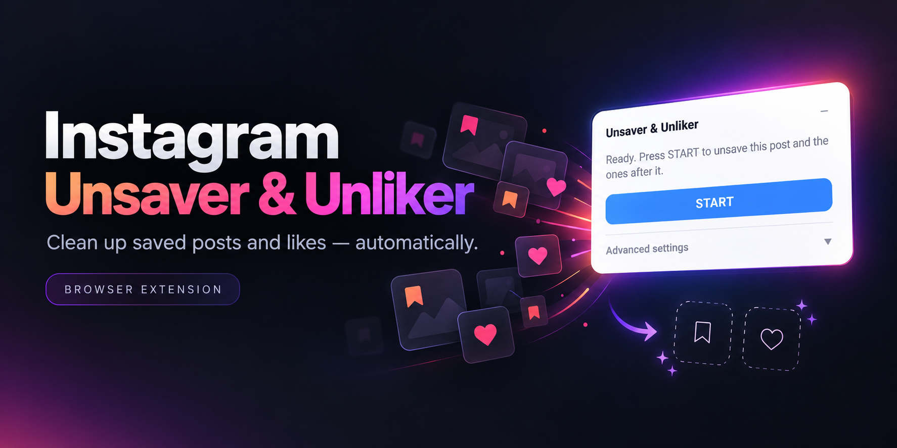

# Instagram Unsaver & Unliker



Bulk-unsave the posts you saved on Instagram, without clicking through them one
by one.

The extension opens each saved post in the post viewer, unsaves it, and moves on
to the next one until your saved list is empty or you press **STOP**.

## Status

| Version   | Feature                                                                                 |
| --------- | --------------------------------------------------------------------------------------- |
| **0.2.0** | **Unsave all** — walks your saved posts from the post viewer, with an adjustable delay. |
| planned   | **Unlike all** — the same loop, driven by the heart button.                             |

The name covers the roadmap: bulk unlike is not in the extension yet, which is
why the extension is still `0.x`. `1.0.0` is reserved for the release that ships
both halves. The click loop is already independent of which control it presses,
so adding unlike means adding the filled-heart icon path and a second button.

## Features

- **Unsave all** — unsaves the open post, clicks the next arrow, repeats.
- **Unlike all** _(planned)_ — the same loop, driven by the heart button instead
  of the bookmark. Not available yet.
- **Start / stop** — one START button and a STOP button in a floating panel; the
  number of unsaved posts is shown while it runs.
- **No API calls** — the extension never talks to Instagram itself. It clicks the
  bookmark button and the page makes the request. No private GraphQL endpoint is
  reverse engineered, and no `doc_id` is hardcoded.
- **Adjustable pacing** — **Advanced settings** in the panel sets the delay
  between actions from 300 ms to 1500 ms in 50 ms steps, and remembers it.
- **Only the `storage` permission** — used to remember that one setting. No
  background worker, no data collection; a single content script that only reads
  the DOM it already lives in.

## Install (unpacked)

1. Clone this repository.
2. Open `chrome://extensions` and enable **Developer mode**.
3. Click **Load unpacked** and select the repository folder.
4. Open Instagram and log in.

## Usage

1. Go to **Your profile → Saved** (or `instagram.com/<username>/saved/`).
2. **Open any post from that list.** This is what tells Instagram to keep walking
   your saved posts when the viewer's next arrow is used.
3. The panel in the top right shows _"Open any post from your saved list…"_ while
   you are on the grid, and switches to **START** once a post is open.
4. Press **START**. The extension unsaves the open post, moves to the next one and
   keeps going. The panel counts what it has unsaved.
5. Press **STOP** at any time. Reloading the tab also stops it.

The **Advanced settings** section at the bottom of the panel sets the delay
between actions (300–1500 ms in 50 ms steps); the choice is remembered on this
device. The `−` button in the panel header collapses the whole panel.

## How it works

Everything is a single content script. It does not call Instagram's API, read
cookies, or touch anything other than the page it runs on.

1. It mounts a namespaced panel (`#igu-panel`) on saved pages
   (`/<username>/saved/…`) and on post pages (`/p/<shortcode>/`,
   `/reel/<shortcode>/`, …).
2. A post counts as saved when the **filled bookmark icon** is rendered — the
   outline icon means it is not saved. The script finds that icon by its SVG
   path, walks up to the surrounding clickable element and clicks it.
3. It then clicks the post viewer's **Next** arrow and repeats.
4. Actions are spaced by the delay set under **Advanced settings** — 300 ms by
   default, up to 1500 ms in 50 ms steps — with controls polled every 50 ms. At
   the default a long run goes well past Instagram's ~200 requests / 5 minutes
   budget; raise it if a run gets throttled.

Because the page performs the requests, the extension keeps working when
Instagram changes its private API. If Instagram changes its icons, the run stops
instead of clicking blindly — see [Troubleshooting](#troubleshooting).

### Project layout

```
manifest.json          Manifest V3 definition (one content script, only `storage`)
src/content.js         Panel, click loop and icon detection
src/content.css        Namespaced panel styles
icons/                 Generated toolbar and store icons
.github/ISSUE_TEMPLATE Bug report template
```

## Troubleshooting

**"This post doesn't look saved…"** — either the post was not opened from the
saved list, or the bookmark icon changed. Open DevTools, inspect the bookmark
button's `<svg><path d="…">` and compare it with `UNSAVE_ICON_PATH` in
`src/content.js`.

**The run stops after one post** — the next arrow was not found. Check
`NEXT_ICON_PATH` the same way; it must match the `path` inside the
`svg[aria-label="Next"]` of the post viewer.

**Instagram throttles the run** — wait 5–10 minutes, then retry with a larger
delay under **Advanced settings**.

## Contributing

Bug reports and pull requests are welcome. Open issues through the
[bug report template](.github/ISSUE_TEMPLATE/bug_report.md) — it asks for the
three things needed to reproduce a problem:

- **What happened**, and what you expected instead.
- **Where** you were: on a saved page, and whether the post was opened from that
  list.
- **The panel's status line** (for example `Done. Unsaved 12 posts.`).

If the run stopped on an icon, paste the `path d="…"` of the control that did not
respond — see [Troubleshooting](#troubleshooting) for how to find it.

For pull requests: keep the change focused, and say which selector or icon path
you touched, since those are the pieces that break when Instagram ships a new
build.

## License

MIT — see [LICENSE](LICENSE).
